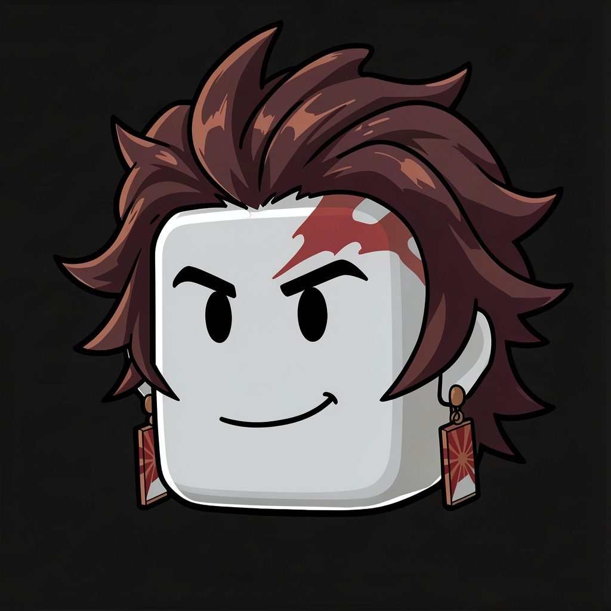
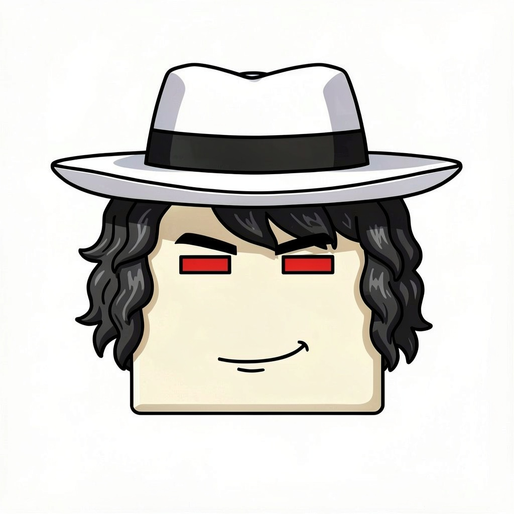

# ECLIPSE — Character selection art

## Current portraits

| Guardião | Criatura |
| --- | --- |
|  |  |
| **TANJIRO** | **MUZAN** |

[**Open the side-by-side selection preview**](./selection-preview-ai.png)

## Visual direction

The character portraits use the supplied Roblox icon style: oversized block-head proportions, strong hand-drawn outlines, readable compact faces and simple cel shading.

- **Tanjiro:** original approved portrait, unchanged.
- **Muzan:** rebuilt from scratch around the supplied white wide-brim hat with black band, pale face, narrow red eyes and black wavy side curls. The previous elongated lower face was discarded and replaced with a broad squared Roblox head and short chin.

## Roblox integration

The portraits are stored as square JPGs. They still need to be uploaded to Roblox as image assets and connected to the faction ImageButtons. The current preview is a visual review sheet, not the in-game GUI.

## Source files

- `tanjiro-roblox-icon-final.jpg` and `muzan-roblox-icon-final.jpg` — current generated portraits.
- `selection-preview-ai.png` — side-by-side faction preview.
- `tanjiro-bacon.svg`, `muzan-bacon.svg` and earlier PNGs — superseded experiments retained for reference.
- `AI-GENERATED-VERSION.md` — generation sources and provenance.
- `.github/workflows/import-ai-character-icons.yml` — downloads the current images, verifies them and rebuilds the preview.

The game was not published as part of this artwork update.
