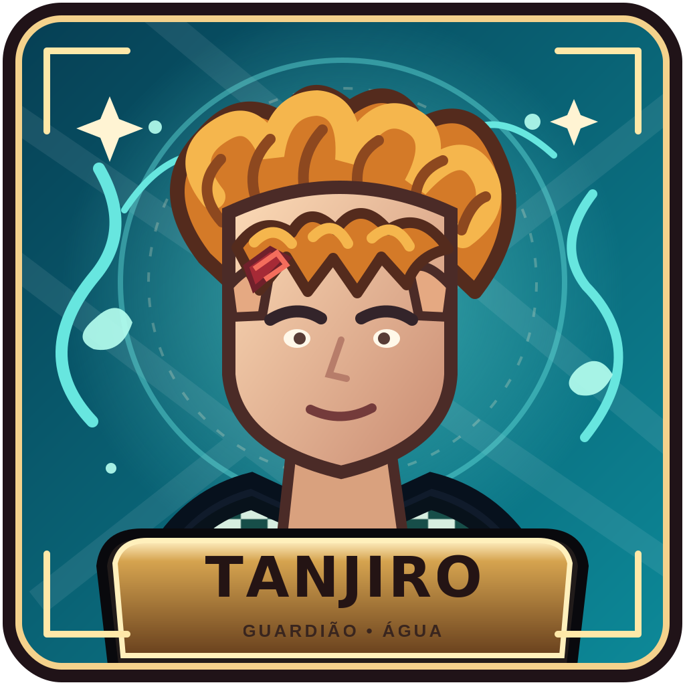
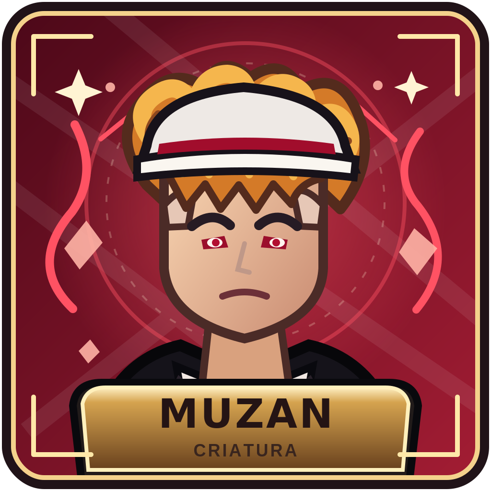

# ECLIPSE — Character selection artwork

Two original, hand-drawn vector selection portraits for the two opposing sides:

| Guardião | Criatura |
| --- | --- |
|  |  |
| **Tanjiro-inspired Bacon Hair** | **Muzan-inspired Bacon Hair** |

[Open the side-by-side comparison](./selection-preview.png)

## Visual direction

The portraits are designed as **selectable game buttons**, not a cinematic scene or pasted anime screenshots. Both use a blocky Roblox avatar head, the recognizable golden/orange Bacon Hair silhouette, expressive drawn faces, thick outlines, a strong two-color background, and a framed nameplate.

- **Tanjiro / Guardião:** teal-water palette, checkered haori, forehead scar, focused but approachable expression.
- **Muzan / Criatura:** crimson palette, pale face, narrow red eyes, dark suit, white fedora and a more threatening expression.

## Reference comparison

The 2019 Roblox DevForum icon critique highlights two useful lessons: a clear focal character and controlled color grouping matter; overly congested colors and generic action clichés weaken recognition. The artwork therefore uses one dominant portrait per button, separate palettes and no unnecessary battle pose.

The 2020 DevForum icon-making example describes capturing Roblox scenes with depth/bloom and finishing them in Paint.NET. That is a useful period reference for strong character framing and post-processing. This implementation translates that era's bold, high-contrast Roblox icon language into original vector illustration instead of copying someone else's render.

- [Roblox DevForum — Game Icons Feedback/Thoughts (Aug. 2019)](https://devforum.roblox.com/t/game-icons-feedbackthoughts/340721)
- [Roblox DevForum — My first game icons/thumbnails (Jul. 2020)](https://devforum.roblox.com/t/my-first-game-iconsthumbnails/676172)
- [Roblox Creator Hub — Experience icons](https://create.roblox.com/docs/production/publishing/experience-icons)

## Files and sizes

- `tanjiro-bacon.svg` — editable vector master, 512×512 viewBox.
- `muzan-bacon.svg` — editable vector master, 512×512 viewBox.
- `tanjiro-bacon.png` and `muzan-bacon.png` — 1024×1024 raster exports generated by GitHub Actions.
- `selection-preview.png` — 1120×600 side-by-side review sheet.

The SVGs are source artwork. Roblox ImageLabels require uploaded raster image assets; the PNG exports are prepared for that upload step. They have **not** been uploaded to Roblox or connected to the in-game buttons yet.
